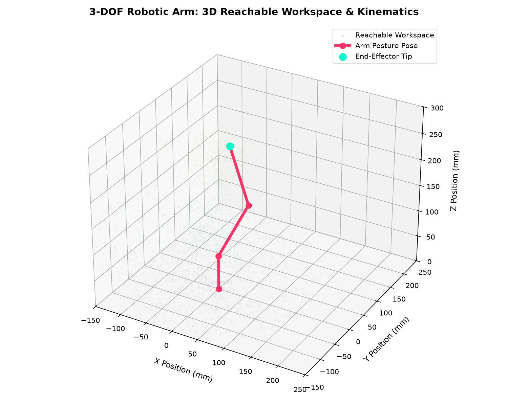

# 🦾 Multi-Degree-of-Freedom Robotic Arm Design & Kinematics Control

[](https://opensource.org/licenses/MIT)
[](https://www.arduino.cc/)
[]()
[]()

> Designed, modeled, and constructed by **K Azaan Ahamed (23BEC0362)**, Himasundar Naidu (23BEC0467), and Talasu Sanjay (23BEC0301) — School of Electronics Engineering (SENSE), VIT Vellore.

An engineering design and implementation of an articulated **3-DOF (Degree of Freedom) spatial robotic arm** featuring analytical inverse and forward kinematics, non-blocking cubic servo trajectory smoothing, autonomous pick-and-place task routines, and a host Python visualizer.

---

## 📌 Project Highlights
- **Degrees of Freedom**: 3 Primary Axes (Base Azimuth Yaw, Shoulder Pitch, Elbow Pitch) + End-Effector Gripper.
- **Microcontroller**: Atmel ATmega328P (Arduino Uno) with hardware PWM timer control.
- **Actuators**: High-precision metal/nylon gear positional servos (TowerPro SG90 / MG996R).
- **Control Modalities**:
  1. Autonomous waypoint trajectory sequencer (pick-and-place cycle with programmable dwell times).
  2. Real-time Cartesian coordinate Inverse Kinematics over Serial (G-code style `MOVE X Y Z GRIP`).
  3. Interactive manual push-button jog mode.
- **Mechanical Payload Capacity**: Validated for handling objects up to 100 grams.

---

## 📐 Kinematics Mathematical Model

```
       (Shoulder Pivot)
             O2 •-----------------• O3 (Elbow Pivot)
               / \     L_UPPER     \
              /   \                 \
             /     \                 \ L_FOREARM
            / L_BASE\                 \
           /         \                 • End Effector (x, y, z)
          O1 (Base)
```

### 1. Forward Kinematics (FK)
Given joint angles $(\theta_1, \theta_2, \theta_3)$:
$$r = L_{upper} \cos(\theta_2) + L_{forearm} \cos(\theta_2 + \theta_3)$$
$$x = r \cos(\theta_1)$$
$$y = r \sin(\theta_1)$$
$$z = L_{base} + L_{upper} \sin(\theta_2) + L_{forearm} \sin(\theta_2 + \theta_3)$$

### 2. Inverse Kinematics (IK)
Given target Cartesian coordinates $(X_t, Y_t, Z_t)$:
1. **Base Angle ($\theta_1$)**:
   $$\theta_1 = \text{atan2}(Y_t, X_t)$$
2. **Radial Distance & Elevation**:
   $$r = \sqrt{X_t^2 + Y_t^2}, \quad z_{rel} = Z_t - L_{base}$$
   $$d = \sqrt{r^2 + z_{rel}^2}$$
3. **Elbow Joint Angle ($\theta_3$)** (Law of Cosines):
   $$\cos(\theta_3) = \frac{d^2 - L_{upper}^2 - L_{forearm}^2}{2 L_{upper} L_{forearm}} \implies \theta_3 = \arccos(\cos(\theta_3))$$
4. **Shoulder Joint Angle ($\theta_2$)**:
   $$\alpha = \text{atan2}(z_{rel}, r), \quad \beta = \arccos\left(\frac{L_{upper}^2 + d^2 - L_{forearm}^2}{2 L_{upper} d}\right)$$
   $$\theta_2 = \alpha + \beta$$

---

## 🔌 Hardware Pinout & Schematics

| Subsystem Component | Arduino Uno Pin | Signal Type | Power Rail |
| :--- | :--- | :--- | :--- |
| **Base Servo (Yaw)** | `D3` | PWM (Timer 2) | External 5V - 6V DC (2A) |
| **Shoulder Servo** | `D5` | PWM (Timer 0) | External 5V - 6V DC (2A) |
| **Elbow Servo** | `D6` | PWM (Timer 0) | External 5V - 6V DC (2A) |
| **Gripper Servo** | `D9` | PWM (Timer 1) | External 5V - 6V DC (2A) |
| **Mode Switch Button** | `D2` | INT0 (Pull-up) | Arduino 5V / GND |
| **Status Indicator LED** | `D13` | Digital Output | Arduino GND |

> ⚠️ **Important Electrical Note**: Servo motors draw peak surge currents exceeding 1.2A during simultaneous acceleration. Never power the servo power bus directly from the Arduino 5V rail; connect a dedicated external regulated 5V/6V DC power supply and tie the DC grounds together.

---

## 📊 Workspace Simulation



Run the Python simulation script to visualize the spatial reachability envelope:
```bash
python3 python/kinematics_sim.py
```

---

## 🚀 Getting Started

### 1. Arduino Firmware
1. Open `src/main.ino` in Arduino IDE or compile via `arduino-cli`.
2. Connect your Arduino Uno over USB.
3. Select board `Arduino Uno` and target serial port.
4. Upload the sketch and open Serial Monitor at **115200 baud**.

### 2. Serial Commands
- `AUTO`: Trigger autonomous continuous pick-and-place cycle.
- `MOVE 120 0 100 45`: Command end-effector to $X=120\text{mm}, Y=0\text{mm}, Z=100\text{mm}$ with gripper at $45^\circ$.
- `HOME`: Smoothly return arm to standard $90^\circ$ neutral home posture.
- `STATUS`: Query current Cartesian coordinates and gripper state.

---

## 📄 License
Released under the [MIT License](LICENSE).
